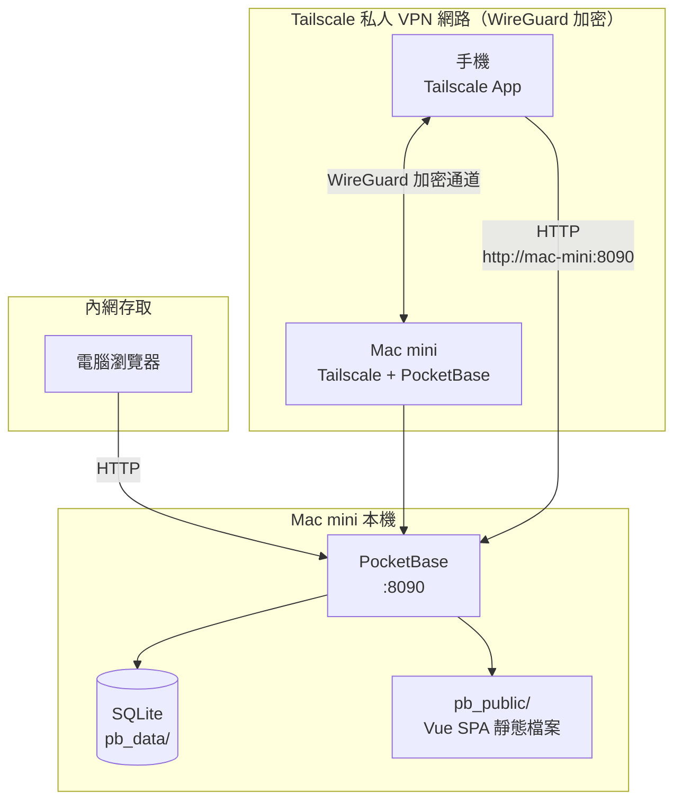
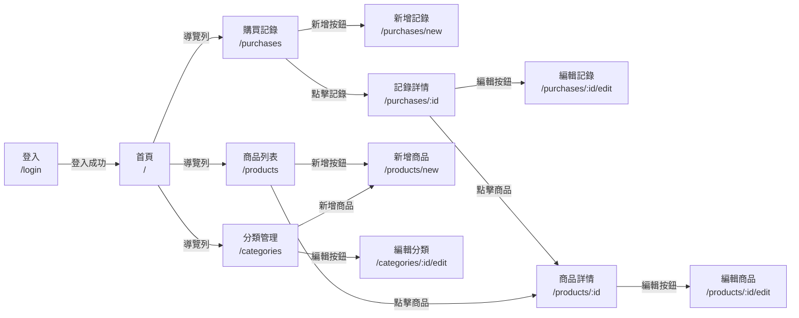
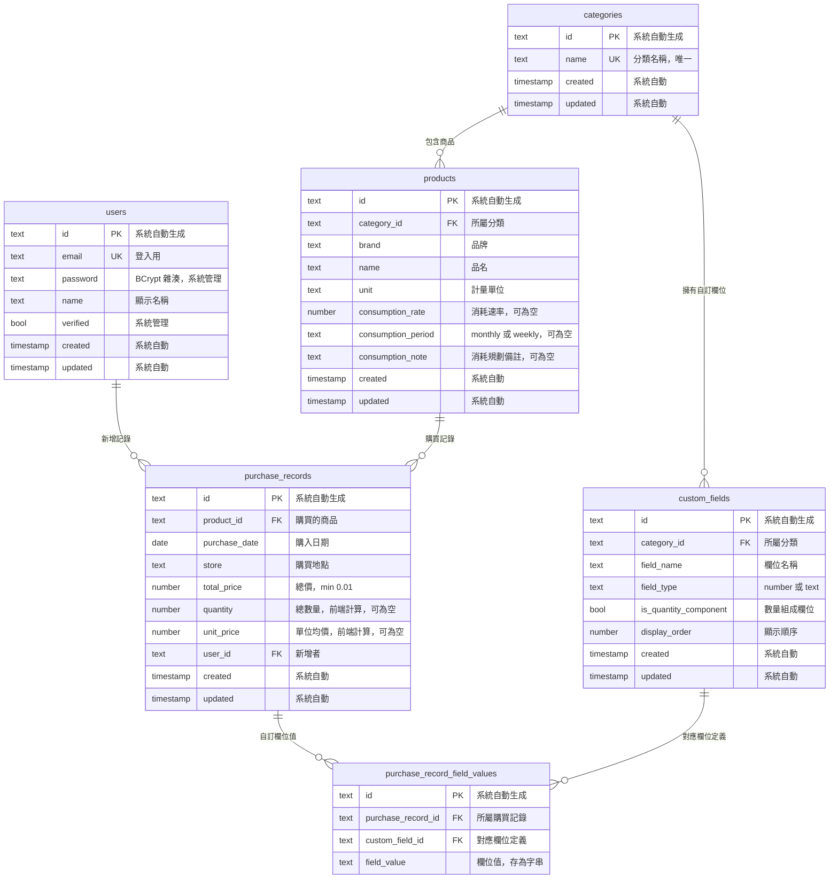

# Design Document

> 版本：v2.0
> 變更摘要：技術架構改為 PocketBase + Vue/Quasar + Tailscale，取代原 Spring Boot + Thymeleaf + PostgreSQL + Cloudflare Tunnel 方案。業務邏輯全部移至前端，後端僅作資料存取層。測試框架改用 Vitest + fast-check。

## Overview

本設計文件定義「home-erp」家庭用品管理 ERP Web 應用程式的技術架構、資料模型、API 設計與測試策略。系統部署於 Apple Silicon M4 Mac mini 上，供 2 位使用者（夫妻）透過 Tailscale 私人 VPN 網路存取，管理家庭用品的購買資訊、價格分析與補貨提醒。

### 設計目標

1. **輕量極簡**：PocketBase 單一執行檔內建 SQLite + REST API + 身份驗證 + 管理後台，幾乎不需要寫後端程式碼，大幅降低學習與維護成本
2. **前後端分離**：前端 Vue 3 SPA 獨立建置，PocketBase 同時提供 API 與靜態檔案服務，部署只需一個目錄
3. **安全存取**：Tailscale mesh VPN 不對外開放任何 port，手機與 Mac mini 在同一私人網路內直接連線，安全性最高
4. **可測試**：核心業務邏輯（價格計算、數量計算、消耗預估）以純函數 composable 實作，支援單元測試與屬性測試

### 關鍵設計決策

| 決策項目 | 選擇 | 理由 |
|---------|------|------|
| 後端 | PocketBase（單一執行檔） | 內建 SQLite、REST API、Auth、Admin UI，零後端程式碼即可啟動 |
| 前端框架 | Vue 3 + Quasar Framework | Quasar 內建 RWD 元件 + PWA 模式，一個框架解決 UI + PWA + 建置 |
| 建置工具 | Vite | Vue 3 官方推薦，建置速度快，Quasar 原生整合 |
| 外網存取 | Tailscale | mesh VPN 免 Port Forwarding、免域名、自動加密，設定約 10 分鐘 |
| 認證機制 | PocketBase 內建 Auth Collection | 使用者帳號由管理後台建立，前端用 PocketBase JS SDK 登入 |
| 自訂欄位 | EAV（Entity-Attribute-Value）模式 | 各分類彈性定義專屬欄位，與 PocketBase Relation 機制整合簡單 |
| 業務邏輯位置 | 前端 composables（純函數） | PocketBase 不執行業務邏輯，所有計算在前端完成後寫入 |
| 價格趨勢圖 | Chart.js（CDN 引入） | 輕量、文件完善，Quasar 不內建圖表元件 |
| 測試框架 | Vitest + fast-check | Vitest 為 Vue 3 生態標準，fast-check 提供屬性測試 |
| 部署方式 | PocketBase 靜態檔案服務（pb_public） | 前端 build 產出複製到 pb_public，PocketBase 同時服務 API 與 SPA |

## Architecture

### 技術選型

#### 後端：為何選 PocketBase（而非 Spring Boot）

| 項目 | PocketBase（推薦） | Spring Boot（原方案） | Node.js + Express |
|------|-------------------|----------------------|-------------------|
| 啟動方式 | 單一執行檔，`./pocketbase serve` 即可 | 需 Java 環境 + Maven 建置 + 設定檔 | 需 Node.js + npm install + 啟動腳本 |
| 資料庫 | 內建 SQLite，零設定 | 需安裝 PostgreSQL + 建立 DB + 連線設定 | 需安裝資料庫 |
| API | 自動生成 CRUD REST API | 需手寫 Controller / Service / Repository | 需手寫路由與資料存取 |
| 管理後台 | 內建 Admin UI，點擊建立 Collection | 需另外建置或使用第三方 | 需另外建置 |
| 身份驗證 | 內建 Auth Collection（email/username + password） | 需 Spring Security 或手寫 Session + Interceptor | 需 passport.js 或手寫 |
| 後端程式碼量 | 幾乎為零（僅需 JS hooks 處理少數驗證） | 大量（Controller、Service、Repository、Entity、DTO） | 中等（路由 + 資料存取） |
| 資源佔用 | 極低（單一 Go binary，~20MB 記憶體） | 較高（JVM + Spring Context） | 中等（Node.js runtime） |
| 學習曲線 | 最平緩（管理後台點擊即可建模） | 較陡（Spring 概念多、Java 語法冗長） | 中等 |

**推薦 PocketBase 的理由：**

1. **零後端程式碼**：Collection（資料表）透過 Admin UI 點擊建立，欄位型別、關聯、驗證全部在 UI 設定，不需要寫 Go 或 SQL
2. **資源極低**：M4 Mac mini 上僅佔約 20MB 記憶體，適合常駐背景執行
3. **自動 REST API**：每個 Collection 自動獲得完整的 CRUD REST API，含分頁、篩選、排序、關聯展開
4. **內建身份驗證**：Auth Collection 提供完整的註冊/登入/token 管理，前端用 JS SDK 一行呼叫
5. **內建靜態檔案服務**：`pb_public` 目錄放入前端 build 產出，PocketBase 同時服務 API 和 SPA

**不選 Spring Boot 的理由：**

1. **過度工程化**：2 人系統不需要 Spring 生態的 DI、AOP、JPA 等重量級機制
2. **後端程式碼量大**：即使 Spring Data JPA 簡化 CRUD，仍需寫 Controller、Service、Entity、DTO 等大量樣板
3. **部署複雜**：需安裝 Java、Maven 建置、PostgreSQL 設定，步驟多
4. **學習曲線陡**：Spring 框架概念多，對新手負擔大

#### 前端：為何選 Quasar（而非 Tailwind / Bootstrap + 手寫元件）

| 項目 | Quasar（推薦） | Bootstrap + 手寫 | Tailwind CSS |
|------|---------------|-----------------|-------------|
| 元件庫 | 內建 100+ RWD 元件（QTable, QForm, QDialog, QInput, QSelect, QBtn 等） | 僅提供 CSS 框架，元件需手寫或另找 | 僅提供 utility CSS，所有元件需手寫 |
| PWA | 內建 PWA 模式，一行指令建置 | 需另設 manifest + service worker | 需另設 manifest + service worker |
| RWD | 內建格線系統與響應式元件 | 有格線系統，但元件需自行組合 | 有響應式 utilities，但元件需手寫 |
| 學習曲線 | 中等（Quasar API 需熟悉，但文件完善） | 低（Bootstrap class 直覺） | 中等（需記大量 utility class） |
| 一致性 | 高（Quasar 元件風格統一） | 中（Bootstrap + 手寫混搭） | 低（全靠開發者維護一致性） |

**推薦 Quasar 的理由：**

1. **一個框架解決所有問題**：UI 元件 + RWD + PWA + 建置工具，不需拼湊多個套件
2. **PWA 原生支援**：Quasar PWA 模式自動生成 manifest 和 service worker，手機可「加到主畫面」
3. **表格與表單強大**：QTable 支援分頁、排序、篩選；QForm 支援驗證；QDialog 支援確認框——正好對應本系統需求
4. **Vue 3 生态標準**：Quasar 完整支援 Vue 3 Composition API + `<script setup>`

**不選 Bootstrap 的理由：** 僅提供 CSS 框架，表格分頁、表單驗證、對話框等互動元件需另行實作或引入額外套件，整合不如 Quasar 一站式。

**不選 Tailwind 的理由：** 所有元件需從零手寫，對學習階段的開發者負擔過大，且難以維護視覺一致性。

#### 外網存取：為何選 Tailscale（而非 Cloudflare Tunnel）

| 項目 | Tailscale（推薦） | Cloudflare Tunnel |
|------|-------------------|-------------------|
| 安全性 | 最高（私人 mesh VPN，設備間點對點加密，不暴露至公網） | 高（但需透過 Cloudflare 中轉，有外部依賴） |
| 設定時間 | ~10 分鐘（兩端各裝 App + 登入） | ~30 分鐘（需域名、DNS 設定、Tunnel 建立） |
| 需要域名 | 不需要（使用 Tailscale MagicDNS，如 `http://mac-mini:8090`） | 需要（需擁有 Cloudflare 管理的域名） |
| HTTPS | Tailscale 連線本身加密（WireGuard），HTTP 即可安全存取 | 需依賴 Cloudflare 簽發 TLS 憑證 |
| 外部依賴 | 僅依賴 Tailscale 服務 | 依賴 Cloudflare 服務 + 域名 |
| 適合場景 | 家庭內網 + 少量固定設備 | 需要公開存取的服務 |

**推薦 Tailscale 的理由：**

1. **安全性最高**：手機和 Mac mini 都在 Tailscale 私人網路內，連線走 WireGuard 加密通道，外部完全無法存取
2. **零設定 HTTPS**：Tailscale 連線本身已加密，PocketBase 只需 HTTP 即可，省去憑證管理
3. **不需域名**：Tailscale MagicDNS 為每台設備分配名稱（如 `mac-mini`），手機直接以 `http://mac-mini:8090` 連線
4. **設定極簡**：Mac mini 和手機各安裝 Tailscale App、登入同一帳號即可，約 10 分鐘

**不選 Cloudflare Tunnel 的理由：** 需要擁有域名、設定 DNS 記錄、管理 Tunnel 設定檔，步驟較多且依賴外部服務。對於僅 2 人使用的家庭系統，Tailscale 更簡單安全。

### 系統架構圖



說明：
- **PocketBase** 監聽 `0.0.0.0:8090`，同時提供 REST API 與靜態前端檔案
- **pb_public/** 目錄存放 Vue SPA build 產出，PocketBase 自動服務
- **SQLite** 資料庫檔案存在 `pb_data/` 目錄，隨 PocketBase 一起部署
- **Tailscale** 在 Mac mini 和手機上各安裝一個，組成私人 VPN，連線走 WireGuard 加密
- **內網存取**：電腦瀏覽器透過區網以 `http://<mac-mini-ip>:8090` 直接存取
- **外網存取**：手機透過 Tailscale 以 `http://mac-mini:8090` 存取（MagicDNS 名稱）

### 部署架構

#### PocketBase 在 Mac mini 上以 launchd 常駐執行

PocketBase 以 macOS 原生的 `launchd` 服務常駐執行，開機自動啟動：

```xml
<!-- ~/Library/LaunchAgents/com.homeerp.pocketbase.plist -->
<?xml version="1.0" encoding="UTF-8"?>
<!DOCTYPE plist PUBLIC "-//Apple//DTD PLIST 1.0//EN"
  "http://www.apple.com/DTDs/PropertyList-1.0.dtd">
<plist version="1.0">
<dict>
  <key>Label</key>
  <string>com.homeerp.pocketbase</string>
  <key>ProgramArguments</key>
  <array>
    <string>/Users/cooqle/home-erp/pocketbase</string>
    <string>serve</string>
    <string>--http=0.0.0.0:8090</string>
  </array>
  <key>WorkingDirectory</key>
  <string>/Users/cooqle/home-erp</string>
  <key>RunAtLoad</key>
  <true/>
  <key>KeepAlive</key>
  <true/>
  <key>StandardOutPath</key>
  <string>/Users/cooqle/home-erp/logs/pocketbase.log</string>
  <key>StandardErrorPath</key>
  <string>/Users/cooqle/home-erp/logs/pocketbase-error.log</string>
</dict>
</plist>
```

部署流程：
1. 下載 PocketBase macOS ARM64 執行檔至 `/Users/cooqle/home-erp/`
2. 執行 `./pocketbase serve` 初始化，透過 Admin UI 建立超級管理員帳號
3. 透過 Admin UI 建立 Collection（資料表）與設定欄位
4. 建立使用者帳號（Auth Collection 種子資料）
5. 前端 `npm run build` 後，將 `dist/` 產出複製到 `pb_public/`
6. 安裝 launchd plist，執行 `launchctl load` 啟動服務

#### 前端靜態檔案部署

前端建置後的靜態檔案直接放入 PocketBase 的 `pb_public/` 目錄，由 PocketBase 自動服務。不需額外的 Web 伺服器（如 Caddy 或 Nginx）。

```bash
# 前端建置
cd home-erp-frontend
npm run build

# 部署到 PocketBase 靜態目錄
cp -r dist/* ../home-erp/pb_public/
```

PocketBase 的 `pb_public/` 機制：
- 若目錄存在，PocketBase 自動將其中的靜態檔案（HTML、JS、CSS、圖片）服務於根路徑
- API 路徑 `/api/*` 仍由 PocketBase 處理，不與靜態檔案衝突
- 需確保 SPA 的路由 fallback（所有非 `/api` 路徑回傳 `index.html`）

#### Tailscale 設定

1. 在 Mac mini 安裝 Tailscale（`brew install tailscale` 或從官網下載 App）
2. 在兩支手機安裝 Tailscale App（iOS App Store / Google Play）
3. 所有設備以同一帳號登入 Tailscale
4. Mac mini 會獲得一個 Tailscale IP 和 MagicDNS 名稱（如 `mac-mini`）
5. 手機以 `http://mac-mini:8090` 存取系統（MagicDNS 自動解析）

### PocketBase 的限制說明

#### 限制 1：EAV 自訂欄位無法用 Schema UI 直接實現

PocketBase 的 Collection Schema 是固定的（每個 Collection 有預先定義的欄位），不支援「動態欄位」或「每筆記錄不同欄位」。因此 REQ-4 的品類自訂欄位需求無法透過管理後台 UI 直接實現。

**解決方案：EAV 模式 + 兩個 Collection**
- `custom_fields` Collection：儲存欄位定義（欄位名稱、型別、是否為數量組成欄位）
- `purchase_record_field_values` Collection：儲存每筆購買記錄的欄位值
- 透過 Relation 關聯到 `categories` 和 `purchase_records`

這與原設計的 EAV 模式相同，只是從 PostgreSQL 資料表改為 PocketBase Collection。詳細設計見 [Data Models](#data-models) 段落。

#### 限制 2：複合唯一約束不支援

PocketBase 的 Schema UI 可設定單一欄位為 unique，但不支援跨欄位的複合唯一約束（如「同分類下品牌+品名不可重複」）。

**解決方案：前端查詢驗證**
- 建立商品前，前端先查詢同分類下是否有相同 brand + name 的商品
- 若存在則顯示錯誤訊息，不送出請求
- 2 人家庭系統前端驗證足夠，不需要伺服器端強制

#### 限制 3：CHECK 約束不支援

PocketBase Schema UI 不支援 CHECK 約束（如「購入日期不可為未來」「總價必須大於 0」）。

**解決方案：**
- `total_price > 0`：PocketBase number 欄位可設定 min 驗證（設 min = 0.01）
- `purchase_date <= today`：前端驗證（送出前檢查日期）
- 未來可選擇加入 PocketBase JS Hook（`onRecordBeforeCreateRequest`）做伺服器端驗證

#### 限制 4：JSVM 僅支援 ES5

PocketBase v0.17+ 內建 JavaScript 虛擬機（JSVM，基於 goja），可撰寫伺服器端 hooks，但**僅支援 ES5 語法**（不支援 `const`/`let`、箭頭函數、模板字串、`async`/`await` 等 ES6+ 語法）。

**影響：** 本系統的業務邏輯全部在前端以 Vue 3 + TypeScript 實作，不依賴 PocketBase JSVM。若未來需要伺服器端驗證，hooks 程式碼需使用 ES5 語法撰寫。

## Components and Interfaces

### PocketBase REST API

PocketBase 為每個 Collection 自動生成完整的 CRUD REST API，前端透過 PocketBase JS SDK（`pocketbase` npm 套件）呼叫。不需手寫任何後端 API 端點。

#### SDK 初始化

```typescript
// src/lib/pocketbase.ts
import PocketBase from 'pocketbase'

const pb = new PocketBase(import.meta.env.VITE_POCKETBASE_URL)
// VITE_POCKETBASE_URL 範例: http://mac-mini:8090 或 http://localhost:8080（開發環境）

export default pb
```

#### 認證 API（PocketBase Auth Collection 內建）

| SDK 方法 | 說明 | 對應需求 |
|----------|------|----------|
| `pb.collection('users').authWithPassword(email, password)` | 登入驗證，成功後自動管理 token | REQ-1.1 |
| `pb.authStore.isValid` | 檢查目前是否已登入 | REQ-1.3, REQ-1.7 |
| `pb.authStore.record` | 取得目前登入使用者資訊 | REQ-1.4, REQ-1.5 |
| `pb.authStore.clear()` | 清除登入狀態（登出） | REQ-1.6 |

#### Collection Records API（自動生成 CRUD）

PocketBase 為每個 Collection 自動提供以下操作，前端透過 SDK 呼叫：

| SDK 方法 | 說明 | 篩選/排序範例 |
|----------|------|---------------|
| `pb.collection('{name}').getList(page, perPage, options)` | 分頁列表 | `filter`, `sort`, `expand` |
| `pb.collection('{name}').getFullList(options)` | 取得全部記錄 | 同上 |
| `pb.collection('{name}').getOne(id, options)` | 取得單筆 | `expand` |
| `pb.collection('{name}').create(data)` | 新增記錄 | — |
| `pb.collection('{name}').update(id, data)` | 更新記錄 | — |
| `pb.collection('{name}').delete(id)` | 刪除記錄 | — |

**PocketBase 篩選語法範例：**
- 依商品篩選購買記錄：`filter: 'product = "record_id"'`
- 依分類篩選商品：`filter: 'category = "category_id"'`
- 依日期區間篩選：`filter: 'purchase_date >= "2025-01-01" && purchase_date <= "2025-12-31"'`

**關聯展開範例：**
- 取得購買記錄時展開商品與分類：`expand: 'product,product.category,user'`
- 展開後可直接存取：`record.expand.product.brand`、`record.expand.product.category.name`、`record.expand.user.name`

#### 邏輯分工：前端 vs PocketBase

| 邏輯 | 處理位置 | 說明 |
|------|----------|------|
| 資料 CRUD | PocketBase 自動 API | 自動提供，不需手寫 |
| 身份驗證 | PocketBase Auth Collection | 內建登入/token 管理 |
| 關聯展開 | PocketBase `expand` 參數 | 自動 JOIN 關聯記錄 |
| 篩選與排序 | PocketBase `filter`/`sort` 參數 | 傳遞查詢條件至 API |
| 單位均價計算 | **前端 composable** | `calculateUnitPrice(totalPrice, quantity)` |
| 數量乘積計算 | **前端 composable** | `calculateQuantityFromComponents(fieldValues, customFields)` |
| 歷史均價計算 | **前端 composable** | `calculateHistoricalAverage(unitPrices)` |
| 消耗預估計算 | **前端 composable** | `calculateDepletionDate(...)`、`getDepletionStatus(...)` |
| 價格比較 | **前端 composable** | `compareWithHistoricalAverage(unitPrice, average)` |
| 資料驗證（必填、格式） | **前端 + PocketBase Schema** | 前端即時驗證，PocketBase Schema 補強 |

#### 需要 PocketBase Hooks 的地方

本系統 MVP **不需要 PocketBase JS Hooks**。所有業務邏輯與驗證在前端完成。

未來若需伺服器端強制驗證，可選擇加入以下 hooks（使用 ES5 語法）：

| Hook | 用途 | 對應需求 |
|------|------|----------|
| `onRecordBeforeCreateRequest` (purchase_records) | 驗證 purchase_date <= 今天 | REQ-5.5 |
| `onRecordBeforeDeleteRequest` (categories) | 驗證分類下無商品才允許刪除 | REQ-2.5 |

> 2 人家庭系統中，前端驗證已足夠。Hooks 為「可選強化」而非必要功能。

### 前端架構（Vue 3 + Quasar）

#### 專案結構

```
home-erp-frontend/
├── src/
│   ├── composables/          # 業務邏輯（純函數，可單元測試）
│   │   ├── useUnitPrice.ts
│   │   ├── useHistoricalAverage.ts
│   │   ├── useQuantityFromComponents.ts
│   │   ├── useDepletionEstimate.ts
│   │   └── useDepletionStatus.ts
│   ├── stores/              # Pinia state 管理
│   │   ├── auth.ts           # useAuthStore
│   │   ├── category.ts       # useCategoryStore
│   │   ├── product.ts        # useProductStore
│   │   └── purchase.ts       # usePurchaseStore
│   ├── pages/                # 路由頁面元件
│   │   ├── Login.vue
│   │   ├── Dashboard.vue
│   │   ├── Categories.vue
│   │   ├── CategoryEdit.vue
│   │   ├── Products.vue
│   │   ├── ProductNew.vue
│   │   ├── ProductDetail.vue
│   │   ├── ProductEdit.vue
│   │   ├── Purchases.vue
│   │   ├── PurchaseNew.vue
│   │   ├── PurchaseDetail.vue
│   │   └── PurchaseEdit.vue
│   ├── components/           # 可重用元件
│   │   ├── PriceTrendChart.vue    # Chart.js 價格趨勢圖
│   │   ├── CustomFieldInput.vue   # 動態自訂欄位輸入
│   │   └── DepletionBadge.vue     # 消耗狀態標籤
│   ├── layouts/              # 版面布局
│   │   └── MainLayout.vue    # 導覽列 + 使用者資訊 + 內容區
│   ├── router/               # Vue Router
│   │   └── index.ts
│   ├── lib/                  # 第三方整合
│   │   └── pocketbase.ts     # PocketBase client 初始化
│   ├── boot/                 # Quasar boot 檔案
│   │   └── pocketbase.ts     # 啟動時初始化 PocketBase + authStore
│   ├── App.vue
│   └── quasar-variables.sass
├── quasar.config.js          # Quasar 設定（含 PWA）
├── package.json
├── tsconfig.json
└── vite.config.ts
```

#### 路由設計（vue-router）

```typescript
// src/router/index.ts
import { createRouter, createWebHistory } from 'vue-router'
import { useAuthStore } from 'stores/auth'

const routes = [
  { path: '/login', component: () => import('pages/Login.vue'), meta: { public: true } },
  { path: '/', component: () => import('pages/Dashboard.vue'), meta: { requiresAuth: true } },
  { path: '/categories', component: () => import('pages/Categories.vue'), meta: { requiresAuth: true } },
  { path: '/categories/:id/edit', component: () => import('pages/CategoryEdit.vue'), meta: { requiresAuth: true } },
  { path: '/products', component: () => import('pages/Products.vue'), meta: { requiresAuth: true } },
  { path: '/products/new', component: () => import('pages/ProductNew.vue'), meta: { requiresAuth: true } },
  { path: '/products/:id', component: () => import('pages/ProductDetail.vue'), meta: { requiresAuth: true } },
  { path: '/products/:id/edit', component: () => import('pages/ProductEdit.vue'), meta: { requiresAuth: true } },
  { path: '/purchases', component: () => import('pages/Purchases.vue'), meta: { requiresAuth: true } },
  { path: '/purchases/new', component: () => import('pages/PurchaseNew.vue'), meta: { requiresAuth: true } },
  { path: '/purchases/:id', component: () => import('pages/PurchaseDetail.vue'), meta: { requiresAuth: true } },
  { path: '/purchases/:id/edit', component: () => import('pages/PurchaseEdit.vue'), meta: { requiresAuth: true } },
]

const router = createRouter({ history: createWebHistory(), routes })

// 路由守衛：未登入導向 /login
router.beforeEach((to) => {
  const authStore = useAuthStore()
  if (to.meta.requiresAuth && !authStore.isAuthenticated) {
    return '/login'
  }
  if (to.path === '/login' && authStore.isAuthenticated) {
    return '/'
  }
})

export default router
```

#### State 管理（Pinia）

**useAuthStore — 認證狀態**

```typescript
// src/stores/auth.ts
import { defineStore } from 'pinia'
import pb from 'lib/pocketbase'

export const useAuthStore = defineStore('auth', {
  state: () => ({
    user: pb.authStore.record,
    token: pb.authStore.token,
  }),
  getters: {
    isAuthenticated: (state) => state.user !== null,
    displayName: (state) => state.user?.name ?? '',
  },
  actions: {
    async login(email: string, password: string) {
      const authData = await pb.collection('users').authWithPassword(email, password)
      this.user = authData.record
      this.token = authData.token
    },
    logout() {
      pb.authStore.clear()
      this.user = null
      this.token = null
    },
  },
})
```

**usePurchaseStore — 購買記錄狀態**

```typescript
// src/stores/purchase.ts（摘要）
import { defineStore } from 'pinia'
import pb from 'lib/pocketbase'
import { calculateUnitPrice, calculateQuantityFromComponents } from 'composables/useUnitPrice'

export const usePurchaseStore = defineStore('purchase', {
  state: () => ({
    records: [] as PurchaseRecord[],
    loading: false,
  }),
  actions: {
    async fetchRecords(filters?: { categoryId?: string; startDate?: string; endDate?: string }) {
      let filter = ''
      if (filters?.categoryId) filter += `product.category = "${filters.categoryId}"`
      if (filters?.startDate && filters?.endDate)
        filter += `purchase_date >= "${filters.startDate}" && purchase_date <= "${filters.endDate}"`
      
      this.records = await pb.collection('purchase_records').getFullList({
        sort: '-purchase_date',
        expand: 'product,product.category,user',
        filter,
      })
    },
    async createRecord(data: PurchaseFormData) {
      // 前端計算 quantity 和 unit_price
      const quantity = data.fieldValues
        ? calculateQuantityFromComponents(data.fieldValues, data.customFields)
        : data.quantity
      const unitPrice = calculateUnitPrice(data.totalPrice, quantity)
      
      const record = await pb.collection('purchase_records').create({
        product: data.productId,
        purchase_date: data.purchaseDate,
        store: data.store,
        total_price: data.totalPrice,
        quantity,
        unit_price: unitPrice,
        user: pb.authStore.record!.id,
      })
      
      // 儲存自訂欄位值（EAV）
      if (data.fieldValues) {
        for (const [fieldId, value] of Object.entries(data.fieldValues)) {
          await pb.collection('purchase_record_field_values').create({
            purchase_record: record.id,
            custom_field: fieldId,
            field_value: String(value),
          })
        }
      }
    },
  },
})
```

#### PocketBase SDK 整合

在 `src/boot/pocketbase.ts` 中初始化 PocketBase client：

```typescript
// src/boot/pocketbase.ts
import { boot } from 'quasar/wrappers'
import pb from 'lib/pocketbase'
import { useAuthStore } from 'stores/auth'

export default boot(({ app }) => {
  // 啟動時從 localStorage 恢復 auth 狀態（PocketBase SDK 自動處理）
  const authStore = useAuthStore()
  authStore.user = pb.authStore.record
  authStore.token = pb.authStore.token
  
  // 監聽 token 過期事件
  pb.authStore.onChange(() => {
    authStore.user = pb.authStore.record
    authStore.token = pb.authStore.token
  })
})
```

#### PWA 設定

在 `quasar.config.js` 中啟用 PWA 模式：

```javascript
// quasar.config.js（PWA 相關設定）
module.exports = {
  pwa: {
    workboxMode: 'generateSW',  // 自動生成 service worker
    manifest: {
      name: '家庭ERP',
      short_name: 'HomeERP',
      description: '家庭用品管理系統',
      display: 'standalone',
      orientation: 'portrait',
      background_color: '#ffffff',
      theme_color: '#027be3',
      icons: [
        { src: 'icons/icon-128.png', sizes: '128x128', type: 'image/png' },
        { src: 'icons/icon-256.png', sizes: '256x256', type: 'image/png' },
        { src: 'icons/icon-512.png', sizes: '512x512', type: 'image/png' },
      ],
    },
  },
}
```

PWA 模式重點：
- **manifest**：定義 App 名稱、圖示、顯示模式，手機「加到主畫面」後以全螢幕 App 形式開啟
- **service worker**（Workbox `generateSW`）：自動快取靜態資源，離線時仍可開啟 App 框架（API 資料仍需網路）
- **建置指令**：`quasar build -m pwa`，產出含 manifest 和 service worker 的完整 PWA

### 前端業務邏輯（核心計算）

此段落是本設計與原方案（Spring Boot）最大的差異：**PocketBase 不執行任何業務邏輯，所有計算在前端完成後寫入資料庫**。

以下計算函數以 Vue 3 composable / 純函數形式實作，放在 `src/composables/`，可獨立單元測試與屬性測試。

#### 1. 單位均價計算

```typescript
// src/composables/useUnitPrice.ts
/**
 * 計算單位均價 = 總價 ÷ 數量
 * 若數量為 0 或 null，回傳 null（前端顯示「無法計算」）
 */
export function calculateUnitPrice(
  totalPrice: number,
  quantity: number | null
): number | null {
  if (quantity === null || quantity === 0) return null
  return Math.round((totalPrice / quantity) * 10000) / 10000  // 保留 4 位小數
}
```

#### 2. 歷史均價計算

```typescript
// src/composables/useHistoricalAverage.ts
/**
 * 計算歷史均價 = 所有單位均價的算術平均
 * 若陣列為空或含 null，回傳 null
 */
export function calculateHistoricalAverage(
  unitPrices: (number | null)[]
): number | null {
  const validPrices = unitPrices.filter((p): p is number => p !== null)
  if (validPrices.length === 0) return null
  const sum = validPrices.reduce((acc, p) => acc + p, 0)
  return Math.round((sum / validPrices.length) * 10000) / 10000
}
```

#### 3. 數量組成計算

```typescript
// src/composables/useQuantityFromComponents.ts
interface CustomField {
  id: string
  field_name: string
  is_quantity_component: boolean
}

/**
 * 將「數量組成欄位」的值相乘作為總數量
 * 若無數量組成欄位，回傳 null（使用直接輸入的數量）
 */
export function calculateQuantityFromComponents(
  fieldValues: Record<string, number>,
  customFields: CustomField[]
): number | null {
  const componentFields = customFields.filter(f => f.is_quantity_component)
  if (componentFields.length === 0) return null
  
  const product = componentFields.reduce((acc, field) => {
    return acc * (fieldValues[field.id] ?? 0)
  }, 1)
  
  return product
}
```

#### 4. 消耗預估計算

```typescript
// src/composables/useDepletionEstimate.ts
/**
 * 計算預計耗盡日期
 * 公式：耗盡日期 = 最近購買日期 + (數量 ÷ 消耗速率) × 週期天數
 * monthly = 30 天，weekly = 7 天
 * 若消耗速率未設定或為 0，回傳 null
 */
export function calculateDepletionDate(
  lastPurchaseQty: number,
  consumptionRate: number | null,
  period: 'monthly' | 'weekly' | null,
  lastPurchaseDate: Date
): Date | null {
  if (!consumptionRate || consumptionRate <= 0 || !period) return null
  
  const periodDays = period === 'monthly' ? 30 : 7
  const days = (lastPurchaseQty / consumptionRate) * periodDays
  
  const result = new Date(lastPurchaseDate)
  result.setDate(result.getDate() + Math.round(days))
  return result
}
```

#### 5. 消耗狀態分類

```typescript
// src/composables/useDepletionStatus.ts
type DepletionStatus = 'unset' | 'normal' | 'soon' | 'depleted'

/**
 * 根據預計耗盡日期與消耗速率分類消耗狀態
 * - unset: 未設定消耗速率（不計算耗盡日期）
 * - normal: 距耗盡日期超過 7 天
 * - soon: 距耗盡日期 0-7 天（即將耗盡）
 * - depleted: 耗盡日期已過（已耗盡）
 */
export function getDepletionStatus(
  depletionDate: Date | null,
  consumptionRate: number | null
): DepletionStatus {
  if (!consumptionRate || consumptionRate <= 0) return 'unset'
  if (!depletionDate) return 'unset'
  
  const today = new Date()
  today.setHours(0, 0, 0, 0)
  const depletion = new Date(depletionDate)
  depletion.setHours(0, 0, 0, 0)
  
  const diffDays = Math.floor(
    (depletion.getTime() - today.getTime()) / (1000 * 60 * 60 * 24)
  )
  
  if (diffDays > 7) return 'normal'
  if (diffDays > 0) return 'soon'
  return 'depleted'
}
```

#### 6. 價格比較

```typescript
// src/composables/usePriceComparison.ts
type PriceComparison = 'higher' | 'lower' | 'equal'

/**
 * 比較當次單位均價與歷史均價
 */
export function compareWithHistoricalAverage(
  unitPrice: number,
  historicalAverage: number
): PriceComparison {
  if (unitPrice > historicalAverage) return 'higher'
  if (unitPrice < historicalAverage) return 'lower'
  return 'equal'
}
```

### 頁面與路由對照

| 頁面 | 路由 | 對應需求 | 說明 |
|------|------|----------|------|
| 登入頁面 | /login | REQ-1 | email/密碼輸入、錯誤訊息顯示，meta: `{ public: true }` |
| 首頁 / 儀表板 | / | REQ-7 | 補貨提醒（即將耗盡、已耗盡商品清單） |
| 分類管理 | /categories | REQ-2 | 分類清單、新增表單 |
| 編輯分類 | /categories/:id/edit | REQ-4 | 分類名稱編輯、自訂欄位管理 |
| 商品列表 | /products | REQ-3, REQ-7 | 商品清單（含消耗預估資訊），可篩選分類 |
| 新增商品 | /products/new | REQ-3 | 品牌、品名、計量單位輸入 |
| 商品詳情 | /products/:id | REQ-6, REQ-7, REQ-8 | 歷史均價、價格趨勢圖、消耗速率設定、購買歷史 |
| 編輯商品 | /products/:id/edit | REQ-7 | 消耗速率、消耗週期、備註設定 |
| 購買記錄列表 | /purchases | REQ-5, REQ-8 | 所有記錄（按日期新→舊），可篩選分類 / 日期 |
| 新增購買記錄 | /purchases/new | REQ-4, REQ-5 | 表單（含自訂欄位動態顯示），前端計算數量與均價 |
| 購買記錄詳情 | /purchases/:id | REQ-6, REQ-8 | 單筆記錄詳情、單位均價與歷史均價比較 |
| 編輯購買記錄 | /purchases/:id/edit | REQ-5 | 編輯表單 |

### 導覽結構



## Data Models

### PocketBase Collection 總覽

PocketBase 使用「Collection」概念（等同資料表），分為三種類型：
- **Auth Collection**：支援身份驗證的 Collection（內建 email/username + password + token 管理）
- **Base Collection**：一般資料 Collection
- **View Collection**：唯讀虛擬 Collection（由 SQL 查詢定義，本系統不使用）

本系統共 6 個 Collection：

| Collection 名稱 | 類型 | 用途 | 對應需求 |
|-----------------|------|------|----------|
| users | Auth | 2 位家庭使用者，支援登入 | REQ-1 |
| categories | Base | 商品分類 | REQ-2 |
| custom_fields | Base | 自訂欄位定義（EAV 定義層） | REQ-4 |
| products | Base | 商品 | REQ-3 |
| purchase_records | Base | 購買記錄 | REQ-5, REQ-6 |
| purchase_record_field_values | Base | 購買記錄自訂欄位值（EAV 值層） | REQ-4 |

### ER 圖



### 各 Collection 欄位定義

以下欄位定義透過 PocketBase Admin UI 建立。PocketBase 自動為每個 Collection 提供 `id`（text，隨機生成）、`created`（timestamp）、`updated`（timestamp）三個系統欄位，不需手動建立。

#### users（Auth Collection — 使用者）

Auth Collection 自帶身份驗證欄位（email、password、tokenKey、verified），以下僅列出需在 Admin UI 設定的部分。

| 欄位 | PocketBase 型別 | 限制 | 說明 |
|------|----------------|------|------|
| email | email | UNIQUE, required | 登入用 email（Auth Collection 內建） |
| password | text (hashed) | required | 密碼（Auth Collection 內建，BCrypt 雜湊） |
| name | text | required | 顯示名稱（顯示於購買記錄與右上角） |

Auth Collection 設定：
- 開啟「Allow username」為關閉（使用 email 登入）
- 不開啟 OAuth2
- 不開啟 Email verification（家庭系統不需要）
- API Rule — List/View: `@request.auth.id != ""`（已登入使用者可查看使用者清單，用於顯示新增者名稱）
- API Rule — Create/Update/Delete: 留空（僅管理員可透過 Admin UI 管理，一般使用者無法自行建立帳號）

> 使用者帳號於環境建置時透過 Admin UI 建立（種子資料），不提供註冊功能。2 位使用者的 email 與初始密碼於第一個 task 中設定。

#### categories（Base Collection — 商品分類）

| 欄位 | PocketBase 型別 | 限制 | 說明 |
|------|----------------|------|------|
| name | text | UNIQUE, required, max 100 | 分類名稱（如「衛生紙」「蔬菜」） |

API Rule — List/View: `@request.auth.id != ""`
API Rule — Create/Update/Delete: `@request.auth.id != ""`

#### custom_fields（Base Collection — 自訂欄位定義）

| 欄位 | PocketBase 型別 | 限制 | 說明 |
|------|----------------|------|------|
| category | relation → categories | required, Cascade | 所屬分類（刪除分類時連帶刪除自訂欄位定義） |
| field_name | text | required, max 100 | 欄位名稱（如「抽數(單包)」「層數」） |
| field_type | select | required, 選項: `['number', 'text']` | 欄位型別 |
| is_quantity_component | bool | required, default false | true = 數量組成欄位，false = 一般資訊欄位 |
| display_order | number | required, default 0, min 0 | 表單中的顯示順序（由小到大） |

API Rule — List/View: `@request.auth.id != ""`
API Rule — Create/Update/Delete: `@request.auth.id != ""`

> 複合唯一約束 `(category_id, field_name)` 無法在 PocketBase Schema UI 設定。由前端在新增/編輯時查詢驗證。

#### products（Base Collection — 商品）

| 欄位 | PocketBase 型別 | 限制 | 說明 |
|------|----------------|------|------|
| category | relation → categories | required, Restrict | 所屬分類（有商品時禁止刪除分類） |
| brand | text | required, max 100 | 品牌（如「春風」） |
| name | text | required, max 200 | 品名（如「抽取式衛生紙」） |
| unit | text | required, max 20 | 計量單位（如「抽」「ml」「g」「片」） |
| consumption_rate | number | optional, min 0.01 | 消耗速率（如 2.0 表示每月/每週消耗 2 單位），未設定時為 null |
| consumption_period | select | optional, 選項: `['monthly', 'weekly']` | 消耗週期，未設定時為 null |
| consumption_note | text | optional, max 500 | 消耗規劃備註（如「2026年預計消耗12包」） |

API Rule — List/View: `@request.auth.id != ""`
API Rule — Create/Update/Delete: `@request.auth.id != ""`

> 複合唯一約束 `(category_id, brand, name)` 無法在 PocketBase Schema UI 設定。由前端在新增時查詢驗證。

#### purchase_records（Base Collection — 購買記錄）

| 欄位 | PocketBase 型別 | 限制 | 說明 |
|------|----------------|------|------|
| product | relation → products | required, Restrict | 購買的商品（有記錄時禁止刪除商品） |
| purchase_date | date | required | 購入日期（前端驗證不可為未來日期） |
| store | text | required, max 100 | 購買地點（如「蝦皮」「全聯」「家樂福」） |
| total_price | number | required, min 0.01 | 總價（必須大於 0） |
| quantity | number | optional, min 0 | 總數量（前端計算後寫入，可為 null） |
| unit_price | number | optional | 單位均價（前端計算後寫入，可為 null） |
| user | relation → users | required | 新增此記錄的使用者 |

API Rule — List/View: `@request.auth.id != ""`
API Rule — Create/Update/Delete: `@request.auth.id != ""`

> `quantity` 和 `unit_price` 由前端 composables 計算後寫入，PocketBase 不執行計算。若 `quantity` 為 null，`unit_price` 也為 null，前端顯示「無法計算」。

#### purchase_record_field_values（Base Collection — 購買記錄自訂欄位值）

| 欄位 | PocketBase 型別 | 限制 | 說明 |
|------|----------------|------|------|
| purchase_record | relation → purchase_records | required, Cascade | 所屬購買記錄（刪除記錄時連帶刪除欄位值） |
| custom_field | relation → custom_fields | required, Cascade | 對應的自訂欄位定義（刪除欄位定義時連帶刪除值） |
| field_value | text | required, max 255 | 欄位值（儲存為字串，使用時前端轉型） |

API Rule — List/View: `@request.auth.id != ""`
API Rule — Create/Update/Delete: `@request.auth.id != ""`

> 複合唯一約束 `(purchase_record_id, custom_field_id)` 無法在 PocketBase Schema UI 設定。由前端邏輯保證一筆記錄對同一欄位只存一個值。

### 自訂欄位機制說明（EAV 模式）

自訂欄位採用 **EAV（Entity-Attribute-Value）模式**，讓每個分類可以彈性定義專屬欄位，不需修改 Collection Schema。

#### 為何選擇 EAV 模式（而非 PocketBase JSON 欄位）

| 方案 | 說明 | 取捨 |
|------|------|------|
| **EAV 模式（採用）** | 分離欄位定義 Collection（`custom_fields`）與欄位值 Collection（`purchase_record_field_values`），透過 Relation 關聯 | 標準 SQL 模式、與 PocketBase Relation 整合簡單、查詢直覺、前端處理清晰 |
| PocketBase JSON 欄位 | 將自訂欄位以 JSON 物件存在 `purchase_records` 的單一 JSON 欄位 | 查詢困難（需用 PocketBase JSON filter 語法）、前端需手動 parse/serialize JSON、無法對個別欄位做型別驗證、JPA/ORM 對 JSON 型別支援不直覺 |

EAV 模式的優勢：
1. **查詢直覺**：每個欄位值是獨立記錄，可用標準 PocketBase filter 查詢
2. **型別驗證**：`field_type` 欄位記錄型別，前端可依型別做驗證
3. **與 PocketBase 整合自然**：Relation 欄位天然支援 EAV 的關聯結構
4. **前端處理清晰**：讀取時 `expand` 關聯即可取得所有欄位值

#### 運作流程

1. **定義層**：使用者在建立或編輯分類時，透過 `category_custom_fields` Collection 新增自訂欄位定義，標記為「數量組成欄位」或「一般資訊欄位」。

2. **值層**：建立購買記錄時，前端根據商品所屬分類的自訂欄位定義動態顯示輸入欄位。填寫的值儲存於 `purchase_record_field_values` Collection。

3. **數量計算**：前端找出該分類中所有 `is_quantity_component = true` 的欄位值，透過 `calculateQuantityFromComponents()` composable 將其相乘作為總數量（`quantity`）。

#### 具體範例（衛生紙分類）

| 步驟 | 說明 |
|------|------|
| 定義自訂欄位 | 衛生紙分類新增 3 個欄位：抽數(單包) [數量組成]、包數 [數量組成]、層數 [一般資訊] |
| 建立購買記錄 | 使用者輸入：抽數 = 120、包數 = 10、層數 = 3 |
| 前端計算數量 | `calculateQuantityFromComponents()` → 120 * 10 = 1200（層數不參與計算） |
| 前端計算均價 | `calculateUnitPrice(599, 1200)` → 0.4992 |
| 寫入 PocketBase | `purchase_records` 存 quantity=1200, unit_price=0.4992 |
|  | `purchase_record_field_values` 存 3 筆記錄（抽數=120、包數=10、層數=3） |

**資料關聯示意：**

```
categories (id=cat1, name=衛生紙)
├── custom_fields (id=cf1, category=cat1, field_name=抽數(單包), is_quantity_component=true)
├── custom_fields (id=cf2, category=cat1, field_name=包數, is_quantity_component=true)
└── custom_fields (id=cf3, category=cat1, field_name=層數, is_quantity_component=false)

products (id=prod1, category=cat1, brand=春風, name=抽取式衛生紙, unit=抽)

purchase_records (id=pr1, product=prod1, total_price=599, quantity=1200, unit_price=0.4992)
├── field_values (id=fv1, purchase_record=pr1, custom_field=cf1, field_value=120)
├── field_values (id=fv2, purchase_record=pr1, custom_field=cf2, field_value=10)
└── field_values (id=fv3, purchase_record=pr1, custom_field=cf3, field_value=3)
```

### 索引設計

PocketBase 自動為 relation 欄位建立索引。2 人系統資料量極小，不需額外手動建立索引。

## Correctness Properties

*A property is a characteristic or behavior that should hold true across all valid executions of a system—essentially, a formal statement about what the system should do. Properties serve as the bridge between human-readable specifications and machine-verifiable correctness guarantees.*

### 屬性反思（Property Reflection）

在完成 prework 分析後，以下為屬性整合與去冗餘的說明：

- **合併 REQ-6.1 與 REQ-6.5**：單位均價的正常計算與數量為 0 的邊界情況，合併為一個完整屬性（Property 1），涵蓋正常計算與「無法計算」兩種情況。
- **合併 REQ-7.4、REQ-7.5 與 REQ-7.7**：「即將耗盡」「已耗盡」「未設定消耗速率」三種狀態分類，合併為一個完整的消耗狀態分類屬性（Property 6），涵蓋所有可能的狀態。
- **保留 REQ-4.3 與 REQ-4.6 為獨立屬性**：前者測試數量計算（乘積），後者測試輸入驗證（拒絕非正值），兩者驗證不同行為，不合併。
- **保留 Property 5 與 Property 6 為獨立屬性**：Property 5 測試耗盡日期的計算公式，Property 6 測試基於日期的狀態分類，兩者驗證不同邏輯層次。

### Property 1: Unit price calculation correctness

*For any* valid total_price (> 0) and quantity (> 0), the calculated unit_price SHALL equal total_price divided by quantity (rounded to 4 decimal places). *For any* total_price where quantity is 0 or null, the system SHALL return null as the unit_price (displayed as "無法計算").

**Validates: Requirements 6.1, 6.5**

### Property 2: Quantity from component fields

*For any* set of quantity component field values (all > 0) defined for a category, the computed total quantity SHALL equal the product of all field values. If no quantity component fields are defined, the system SHALL return null (indicating direct quantity input should be used instead).

**Validates: Requirements 4.3**

### Property 3: Quantity component field validation

*For any* quantity component field value less than or equal to 0, the system SHALL reject the input and display the error message "數量組成欄位必須大於 0".

**Validates: Requirements 4.6**

### Property 4: Historical average calculation

*For any* set of purchase records for a product where all records have valid unit prices, the historical average SHALL equal the arithmetic mean of all unit prices, and the result SHALL be bounded between the minimum and maximum unit prices.

**Validates: Requirements 6.3**

### Property 5: Depletion date calculation

*For any* product with a valid last purchase quantity (> 0), consumption rate (> 0), and consumption period, the estimated depletion date SHALL equal the last purchase date plus (quantity / consumption_rate) multiplied by period_days (monthly = 30, weekly = 7).

**Validates: Requirements 7.2**

### Property 6: Depletion status classification

*For any* product, the depletion status SHALL be correctly classified as follows:
- If consumption_rate is not set (null or 0): "未設定消耗速率" (no depletion date computed)
- If days_until_depletion > 7: normal (no alert displayed)
- If 0 < days_until_depletion <= 7: "即將耗盡"
- If days_until_depletion <= 0: "已耗盡"

**Validates: Requirements 7.4, 7.5, 7.7**

### Property 7: Price comparison with historical average

*For any* purchase record's unit_price and the product's historical average, the comparison result SHALL be correctly classified as "高於" (unit_price > average), "低於" (unit_price < average), or "等於" (unit_price == average).

**Validates: Requirements 8.9**

## Error Handling

### 錯誤處理策略

| 錯誤類型 | 處理方式 | 實作層級 |
|----------|----------|----------|
| 表單驗證錯誤（必填、格式） | 前端即時驗證，Quasar QForm + QInput 的 `rules` 屬性，失敗時在欄位旁顯示錯誤訊息 | 前端元件 |
| 業務邏輯錯誤（重複、關聯限制） | 前端在送出前查詢驗證，或 PocketBase 回傳錯誤後前端攔截並顯示對應訊息 | 前端 store + API 攔截 |
| 數量計算錯誤（除以 0） | `calculateUnitPrice()` 檢查 quantity，為 0 或 null 時回傳 null，前端顯示「無法計算」 | 前端 composable |
| PocketBase API 錯誤（HTTP 4xx） | 前端攔截 PocketBase SDK 拋出的 `ClientResponseError`，根據狀態碼顯示對應訊息 | 前端 store |
| PocketBase API 錯誤（HTTP 5xx） | 顯示「系統暫時無法使用，請稍後再試」 | 前端 store |
| 網路中斷（Tailscale 未連線） | PocketBase SDK 請求超時/失敗，前端顯示「無法連線至伺服器，請確認 Tailscale 連線狀態」 | 前端 store |
| CDN 載入失敗（Chart.js） | 圖表區域顯示「圖表載入失敗」，頁面其餘功能正常 | 前端元件 |

### PocketBase API 錯誤處理

PocketBase JS SDK 在 API 請求失敗時拋出 `ClientResponseError`，包含 `status`（HTTP 狀態碼）和 `response`（錯誤詳情）。

```typescript
// 前端攔截 PocketBase 錯誤的通用模式
import { ClientResponseError } from 'pocketbase'

try {
  await pb.collection('categories').create({ name })
} catch (error) {
  if (error instanceof ClientResponseError) {
    if (error.status === 400) {
      // 驗證失敗（如 unique constraint 衝突）
      Notify.create({ type: 'negative', message: '此分類名稱已存在，請使用其他名稱' })
    } else if (error.status === 404) {
      Notify.create({ type: 'negative', message: '找不到指定的資料' })
    } else {
      Notify.create({ type: 'negative', message: '系統暫時無法使用，請稍後再試' })
    }
  } else {
    // 網路錯誤（Tailscale 未連線、伺服器未啟動）
    Notify.create({ type: 'negative', message: '無法連線至伺服器，請確認 Tailscale 連線狀態' })
  }
}
```

### 網路中斷處理（Tailscale 未連線）

當使用者外出但未連上 Tailscale，或 Mac mini 上的 PocketBase 服務未啟動時：

1. **API 請求失敗**：PocketBase SDK 拋出網路錯誤（非 `ClientResponseError`，而是 `TypeError: Failed to fetch`）
2. **前端攔截**：store 層的 `try/catch` 攔截，顯示「無法連線至伺服器，請確認 Tailscale 連線狀態」
3. **PWA 離線快取**：service worker 快取的靜態資源仍可載入 App 框架，但 API 資料無法取得，顯示「離線模式，無法載入最新資料」

### 雙層驗證策略

| 驗證項目 | 前端驗證 | PocketBase Schema 驗證 | 說明 |
|----------|----------|----------------------|------|
| 必填欄位 | Quasar QInput rules | Schema required checkbox | 雙層保障 |
| total_price > 0 | 前端 rules | Schema min = 0.01 | 雙層保障 |
| 分類名稱唯一 | 前端查詢 | Schema unique checkbox | 雙層保障 |
| 品牌+品名唯一（複合） | 前端查詢驗證 | 不支援 | 僅前端 |
| 購入日期 <= 今天 | 前端 rules | 不支援 | 僅前端 |
| 數量組成欄位 > 0 | 前端 rules | 不支援 | 僅前端 |
| 結束日期 >= 開始日期 | 前端 rules | 不支援 | 僅前端 |

### 提示訊息與錯誤訊息集中表

以下表格整合 requirements.md 中所有提示訊息與錯誤訊息，供實作時統一管理。建議在前端以常數檔或列舉集中定義，搭配 Quasar Notify plugin 顯示。

#### 成功訊息

| 編號 | 訊息文字 | 觸發情境 | 對應需求 |
|------|----------|----------|----------|
| MSG-001 | 分類建立成功 | 建立分類成功 | REQ-2.2 |
| MSG-002 | 分類刪除成功 | 刪除分類成功 | REQ-2.6 |
| MSG-003 | 商品建立成功 | 建立商品成功 | REQ-3.1（設計補充） |
| MSG-004 | 記錄新增成功 | 建立購買記錄成功 | REQ-5.2 |
| MSG-005 | 記錄更新成功 | 更新購買記錄成功 | REQ-5.7 |
| MSG-006 | 記錄刪除成功 | 刪除購買記錄成功 | REQ-5.9 |
| MSG-007 | 商品更新成功 | 更新商品（消耗速率等）成功 | REQ-7.1（設計補充） |

> 標註「設計補充」的訊息未在 requirements.md 中明確列出，但為保持使用者體驗一致性而新增。

#### 錯誤訊息

| 編號 | 訊息文字 | 觸發情境 | 對應需求 |
|------|----------|----------|----------|
| ERR-001 | 帳號或密碼錯誤，請重新輸入 | 登入帳號或密碼錯誤 | REQ-1.2 |
| ERR-002 | 分類名稱不可為空 | 分類名稱為空字串 | REQ-2.3 |
| ERR-003 | 此分類名稱已存在，請使用其他名稱 | 分類名稱重複 | REQ-2.4 |
| ERR-004 | 此分類下仍有商品，無法刪除 | 刪除已關聯商品的分類 | REQ-2.5 |
| ERR-005 | 品牌與品名不可為空 | 品牌或品名為空 | REQ-3.3 |
| ERR-006 | 請設定計量單位 | 未輸入計量單位 | REQ-3.4 |
| ERR-007 | 此品牌與品名已存在於此分類 | 同分類下品牌 + 品名重複 | REQ-3.6 |
| ERR-008 | 數量組成欄位必須大於 0 | 數量組成欄位輸入 <= 0 | REQ-4.6 |
| ERR-009 | 此欄位為必填 | 必填欄位未填寫 | REQ-5.3 |
| ERR-010 | 總價必須大於 0 | 總價 <= 0 | REQ-5.4 |
| ERR-011 | 購入日期不可為未來日期 | 購入日期為未來日期 | REQ-5.5 |
| ERR-012 | 結束日期不可早於開始日期 | 日期區間篩選時結束 < 開始 | REQ-8.7 |
| ERR-013 | 系統暫時無法使用，請稍後再試 | PocketBase API 5xx 錯誤 | 設計補充 |
| ERR-014 | 無法連線至伺服器，請確認 Tailscale 連線狀態 | 網路中斷或伺服器未啟動 | 設計補充 |

#### 確認對話框

| 編號 | 訊息文字 | 觸發情境 | 對應需求 |
|------|----------|----------|----------|
| CONFIRM-001 | 確定要刪除此筆記錄嗎？ | 點擊刪除購買記錄按鈕時 | REQ-5.8 |

#### 系統狀態訊息

| 編號 | 訊息文字 | 觸發情境 | 對應需求 |
|------|----------|----------|----------|
| STATUS-001 | 無法計算 | 數量為 0 或缺失時的單位均價 | REQ-6.5 |
| STATUS-002 | 未設定消耗速率 | 商品未設定消耗速率 | REQ-7.7 |
| STATUS-003 | 即將耗盡 | 預計耗盡日期距今 <= 7 天 | REQ-7.4 |
| STATUS-004 | 已耗盡 | 預計耗盡日期已過 | REQ-7.5 |
| STATUS-005 | 圖表載入失敗 | Chart.js CDN 載入失敗 | 設計補充 |

### 外部依賴

| 依賴 | 用途 | 版本 | 失敗時處理方式 |
|------|------|------|---------------|
| PocketBase | 後端（API + DB + 靜態檔案服務） | 0.22+ | 服務未啟動時前端顯示 ERR-014；SQLite 檔案損毀需從備份還原 |
| Vue 3 | 前端框架 | 3.4+ | 編譯期錯誤，不會進入執行期 |
| Quasar Framework | UI 元件 + PWA + 建置 | 2.15+ | CDN 不適用（Vite 建置打包），不會執行期失敗 |
| Pinia | 前端 state 管理 | 2.1+ | 編譯期依賴 |
| pocketbase (npm) | PocketBase JS SDK | 0.21+ | API 請求失敗時拋出 `ClientResponseError`，前端攔截處理 |
| Chart.js | 價格趨勢圖（CDN 引入） | 4.x | CDN 失敗時圖表區域顯示 STATUS-005，頁面其餘功能正常 |
| Tailscale | 外網私人 VPN | latest | 通道中斷時外網無法存取，內網不受影響，需重新連接 Tailscale |
| fast-check | 屬性測試框架 | 3.x | 僅用於測試，不影響正式環境 |
| Vitest | 單元測試框架 | 1.x+ | 僅用於測試，不影響正式環境 |

## Testing Strategy

### 雙重測試方針

本系統採用三層測試策略，互相補涵蓋：

| 測試類型 | 測試對象 | 工具 | 數量 |
|----------|----------|------|------|
| 單元測試（Unit Test） | 前端 composables（純函數）、元件、stores | Vitest + Vue Test Utils | 每個函數/元件 2-3 個範例 |
| 屬性測試（Property Test） | 前端 composables 的通用屬性 | fast-check | 每個 Correctness Property 一個測試 |
| 整合測試（Integration/E2E） | 完整使用者流程（前端 → PocketBase API） | Vitest + MSW 或 Playwright | 每個主要流程 1-2 個測試 |

### 單元測試（Unit Test）

**測試範圍：**
- 前端 composables 的具體範例與邊界條件
- 表單驗證邏輯
- Pinia store 的 action 行為（mock PocketBase SDK）

**測試配置：**
- 使用 Vitest（Vue 3 生態標準選擇，與 Vite 原生整合）
- 使用 `vi.mock()` 模擬 PocketBase SDK
- 使用 Vue Test Utils 測試元件
- 不啟動真實 PocketBase 伺服器（速度快）

**單元測試清單（依驗收條件分類為 EXAMPLE 與 EDGE_CASE 的項目）：**

| 測試標的 | 對應需求 | 測試類型 |
|----------|----------|----------|
| 正確帳號密碼登入成功 | REQ-1.1 | EXAMPLE |
| 錯誤密碼登入失敗 | REQ-1.2 | EXAMPLE |
| 登出清除 authStore | REQ-1.6 | EXAMPLE |
| 建立分類成功 | REQ-2.2 | EXAMPLE |
| 空分類名稱被拒 | REQ-2.3 | EDGE_CASE |
| 重複分類名稱被拒 | REQ-2.4 | EDGE_CASE |
| 刪除空分類成功 | REQ-2.6 | EXAMPLE |
| 建立商品成功 | REQ-3.1 | EXAMPLE |
| 空品牌品名被拒 | REQ-3.3 | EDGE_CASE |
| 未設定單位被拒 | REQ-3.4 | EDGE_CASE |
| 重複品牌品名被拒 | REQ-3.6 | EDGE_CASE |
| 總價 <= 0 被拒 | REQ-5.4 | EDGE_CASE |
| 未來日期被拒 | REQ-5.5 | EDGE_CASE |
| 必填欄位缺失被拒 | REQ-5.3 | EDGE_CASE |
| 結束日期早於開始日期被拒 | REQ-8.7 | EDGE_CASE |

### 屬性測試（Property-Based Test）

**PBT 適用性說明：**

本系統的核心業務邏輯位於前端 composables（純函數），這些函數：
- 有明確的輸入/輸出行為
- 行為隨輸入有意義變化
- 輸入空間大（任意正數、任意日期）
- 可在記憶體內執行（不需外部依賴）

因此 PBT 適用於這些純計算函數。UI 渲染、CRUD 操作、認證流程則以單元測試與整合測試涵蓋。

**PBT 套件選擇：fast-check 3.x**

fast-check 是 JavaScript/TypeScript 生態的屬性測試框架，類似 QuickCheck（Haskell）與 Hypothesis（Python），與 Vitest 完美整合。

**PBT 配置需求：**

- 每個屬性測試**最少執行 100 次迭代**（因隨機生成）
- 每個 Correctness Property 對應**一個**屬性測試方法
- 每個測試方法以註解標記對應的設計屬性
- 標記格式：`// Feature: home-erp, Property N: property_text`

**屬性測試清單：**

| 測試方法 | 對應屬性 | 驗證需求 | 測試策略 |
|----------|----------|----------|----------|
| testUnitPriceCalculation | Property 1 | REQ-6.1, REQ-6.5 | 生成隨機 total_price > 0 和 quantity > 0，驗證 unit_price = total / qty；生成 quantity = 0，驗證回傳 null |
| testQuantityFromComponents | Property 2 | REQ-4.3 | 生成隨機正整數集合作為數量組成欄位值，驗證乘積正確；生成空集合，驗證回傳 null |
| testQuantityComponentValidation | Property 3 | REQ-4.6 | 生成隨機非正值（0 和負數），驗證全部被拒；生成隨機正值，驗證全部通過 |
| testHistoricalAverageCalculation | Property 4 | REQ-6.3 | 生成隨機 unit_price 集合，驗證平均值 = mean，且 min <= avg <= max |
| testDepletionDateCalculation | Property 5 | REQ-7.2 | 生成隨機 quantity、rate、period、date，驗證耗盡日期 = date + (qty/rate) * period_days |
| testDepletionStatusClassification | Property 6 | REQ-7.4, REQ-7.5, REQ-7.7 | 生成隨機耗盡日期（涵蓋未設定、正常、即將耗盡、已耗盡），驗證狀態分類正確 |
| testPriceComparison | Property 7 | REQ-8.9 | 生成隨機 unit_price 和 historical_average，驗證比較結果正確 |

**fast-check 測試範例（Property 1）：**

```typescript
// src/composables/__tests__/useUnitPrice.property.test.ts
import { describe, it, expect } from 'vitest'
import fc from 'fast-check'
import { calculateUnitPrice } from '../useUnitPrice'

describe('Property 1: Unit price calculation correctness', () => {
  // Feature: home-erp, Property 1: Unit price calculation correctness
  it('should calculate unit_price = total_price / quantity for valid inputs', () => {
    fc.assert(fc.property(
      fc.float({ min: 0.01, max: 100000 }),
      fc.float({ min: 0.01, max: 10000 }),
      (totalPrice, quantity) => {
        const unitPrice = calculateUnitPrice(totalPrice, quantity)
        const expected = Math.round((totalPrice / quantity) * 10000) / 10000
        return Math.abs((unitPrice ?? 0) - expected) < 0.0001
      }
    ))
  })

  // Feature: home-erp, Property 1: Unit price calculation correctness (zero quantity)
  it('should return null when quantity is 0', () => {
    fc.assert(fc.property(
      fc.float({ min: 0.01, max: 100000 }),
      (totalPrice) => {
        const unitPrice = calculateUnitPrice(totalPrice, 0)
        return unitPrice === null
      }
    ))
  })

  // Feature: home-erp, Property 1: Unit price calculation correctness (null quantity)
  it('should return null when quantity is null', () => {
    fc.assert(fc.property(
      fc.float({ min: 0.01, max: 100000 }),
      (totalPrice) => {
        const unitPrice = calculateUnitPrice(totalPrice, null)
        return unitPrice === null
      }
    ))
  })
})
```

**fast-check 測試範例（Property 6）：**

```typescript
// src/composables/__tests__/useDepletionStatus.property.test.ts
import { describe, it, expect } from 'vitest'
import fc from 'fast-check'
import { getDepletionStatus } from '../useDepletionStatus'

describe('Property 6: Depletion status classification', () => {
  // Feature: home-erp, Property 6: Depletion status classification
  it('should classify unset when consumption rate is null or 0', () => {
    fc.assert(fc.property(
      fc.constantFrom(null, 0, -1),
      (rate) => {
        const status = getDepletionStatus(new Date(), rate)
        return status === 'unset'
      }
    ))
  })

  it('should classify "soon" when days until depletion is 1-7', () => {
    fc.assert(fc.property(
      fc.integer({ min: 1, max: 7 }),
      (daysUntil) => {
        const depletionDate = new Date()
        depletionDate.setDate(depletionDate.getDate() + daysUntil)
        const status = getDepletionStatus(depletionDate, 1.0)
        return status === 'soon'
      }
    ))
  })

  it('should classify "depleted" when depletion date has passed', () => {
    fc.assert(fc.property(
      fc.integer({ min: 1, max: 365 }),
      (daysPast) => {
        const depletionDate = new Date()
        depletionDate.setDate(depletionDate.getDate() - daysPast)
        const status = getDepletionStatus(depletionDate, 1.0)
        return status === 'depleted'
      }
    ))
  })
})
```

### 整合測試（Integration Test）

**測試範圍：**
- 完整使用者流程：前端元件 → Pinia store → PocketBase SDK → API 回應
- 認證流程（路由守衛、登入/登出）
- 資料查詢、篩選、排序
- 購買記錄建立（含前端計算 quantity/unit_price 後寫入）

**測試策略選項：**

| 選項 | 說明 | 優缺點 |
|------|------|--------|
| MSW（Mock Service Worker） | 攔截 HTTP 請求，模擬 PocketBase API 回應 | 速度快、不需真實 PocketBase，但模擬的 API 行為可能與真實不一致 |
| Playwright（E2E） | 啟動真實瀏覽器 + 真實 PocketBase 實例 | 最真實，但需啟動 PocketBase 測試實例，速度較慢 |

**推薦策略**：主要使用 MSW 模擬 API 回應做整合測試（速度快），另以 1-2 個 Playwright E2E 測試驗證關鍵流程（如登入 → 建立記錄 → 查看歷史）。

**整合測試清單：**

| 測試標的 | 對應需求 | 測試方式 |
|----------|----------|----------|
| 未登入存取被攔截重定向 | REQ-1.3 | 渲染受保護路由但未設定 authStore，驗證重定向至 /login |
| Session 持久性 | REQ-1.7 | 模擬頁面刷新，驗證 authStore 從 localStorage 恢復 |
| 分類列表頁面顯示 | REQ-2.1 | MSW 回傳分類資料，渲染頁面，驗證清單正確 |
| 刪除有商品的分類被拒 | REQ-2.5 | MSW 回傳 400 錯誤，驗證顯示 ERR-004 |
| 動態自訂欄位顯示 | REQ-4.5 | 建立有自訂欄位的分類商品，渲染新增記錄表單，驗證欄位出現 |
| 購買記錄自動記錄使用者 | REQ-5.6 | 登入後建立記錄，驗證 user 欄位設為當前使用者 ID |
| 購買記錄前端計算寫入 | REQ-6.1 | 填入總價與數量組成欄位值，驗證 API 請求包含計算後的 quantity 和 unit_price |
| 購買記錄按日期排序 | REQ-8.1 | MSW 回傳多筆不同日期記錄，驗證列表按日期降序排列 |
| 分類篩選 | REQ-8.5 | 設定篩選條件，驗證 API 請求的 filter 參數正確 |
| 日期區間篩選 | REQ-8.6 | 設定日期區間，驗證 API 請求的 filter 參數正確 |
| 首頁補貨提醒 | REQ-7.6 | MSW 回傳即將耗盡/已耗盡商品，渲染首頁，驗證提醒清單正確 |
| 響應式設計 | REQ-9.2 | 以手機 viewport 尺寸渲染頁面，驗證 Quasar RWD class 正確套用 |
